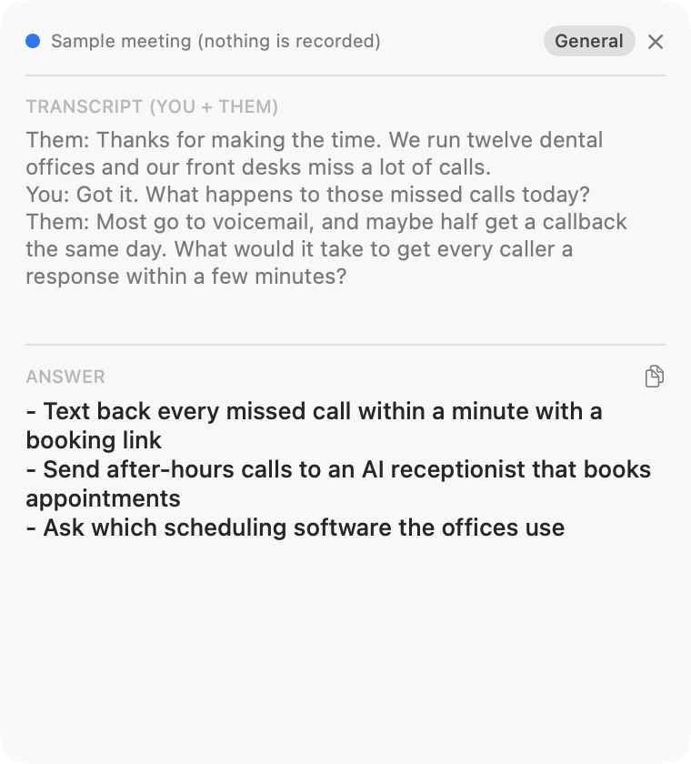

# Meeting Assistant

**A private, bot-free live copilot for your calls.** Meeting Assistant listens to your
Mac's audio (the other people on a Zoom, Meet or Teams call) and your microphone,
transcribes both on your Mac, and shows Claude's suggestions in a small floating
overlay while the conversation is still happening.

<p align="center">
  
</p>

- **Your call audio stays on your Mac.** Transcription runs on-device; only transcript
  text goes to Claude, with your own API key: a recent excerpt when you ask for help,
  and the whole call only if you choose Summarize Meeting. (On macOS 14-15, if your
  Mac can't transcribe your language on-device, Apple's speech servers are used only
  after a separate opt-in.)
- **No bot joins the call.** Nothing appears in the participant list, and it works
  with any app that plays sound.
- **Help while it's still useful.** Press ⌃⌥Space for suggestions, or let auto-answer
  respond whenever the other side asks a question. Afterwards, Summarize Meeting turns
  the call into decisions and action items.
- **Free and open source** under the MIT license. Bring your own Anthropic API key;
  there is no subscription.

Made by [Stephen Thorn](https://stephenthorn.com).

## Try it in 15 seconds

Launch the app and choose **Try a Sample Meeting** on the welcome screen (or from the
menu bar icon). A scripted sales call plays in the overlay and Claude suggests what to
say next; without an API key you get sample answers. Nothing is recorded.

## Use it on your own sales calls

Pick the **Sales** profile and describe what you sell under **Settings > Extra
instructions**, for example:

> I sell <your product or service>. When the prospect describes a problem it solves,
> suggest it in one line, plus one question that qualifies the need.

Start listening before the call and keep the overlay beside it. Tell the people you
talk to that you use an AI assistant (see [Consent](#consent)).

## How it works

```
system audio (ScreenCaptureKit)  -> "Them" transcriber -\
microphone (AVAudioEngine)       -> "You"  transcriber -/
      -> merged, speaker-labeled transcript
      -> [⌃⌥Space or auto-answer] -> Claude Messages API (streaming)
      -> floating overlay (local, non-activating)
      -> [Summarize Meeting] -> whole transcript -> Claude -> summary window
      -> [Save transcripts on] -> Markdown file in a folder on this Mac
```

## Features

- Two-sided transcription: system audio (them) + microphone (you), merged into one
  speaker-labeled transcript in the order people spoke.
- **Listen to the meeting app only.** Settings > Meeting audio takes "All apps" or one
  running app (Zoom, Teams, Webex, FaceTime, Slack or a browser), so music and
  notification sounds stay out of "Them". An app is captured whole: pick a browser and
  audio from all of its tabs is heard, not only the call's. If the chosen app isn't
  running when you start, every app is heard and the overlay says so.
- On-device STT: SpeechAnalyzer on macOS 26+, SFSpeechRecognizer on 14-15. If a
  14-15 Mac can't transcribe your language on-device, nothing is transcribed
  unless you separately allow Apple's speech servers in Settings.
- Optional **Deepgram** cloud STT for the hardest audio, off until you confirm
  sending it audio. It keeps the stream alive through silences and reconnects if
  the connection drops.
- **Capture health you can see.** Two small level bars (You / Them) in the overlay show
  that both sides are being heard. Each side is watched: capture that stops delivering
  audio, or a transcriber that hears speech and writes nothing, is restarted once and
  then reported, and a side that cannot work is named in the status ("their side
  only"). System audio is brought back after the Mac sleeps or a display changes.
- **A status line that names where things go.** While listening it shows the speech
  backend and the Claude model, for example `Listening (on-device) - Haiku 4.5`, in
  the overlay and at the top of the menu.
- Live Claude answers streamed into the overlay, with a copy button.
- **Auto-answer** when the other side asks a question. It never interrupts an answer
  in progress: a question asked meanwhile waits and is answered afterwards if it is
  still recent (30 seconds), otherwise it is skipped with a note under the answer.
- **Summarize Meeting** (menu bar icon): sends the whole transcript, fenced as untrusted
  text, to Claude and shows decisions and action items in a window you can copy from.
  It works while listening and after Stop.
- **Saved transcripts**, off until you turn them on (Settings > Transcripts): each call
  is written as a timestamped Markdown file every 30 seconds and when you stop, into
  `~/Library/Application Support/Meeting Assistant/Transcripts` or a folder you pick.
  Files are readable only by you, and Meeting Assistant never sends them anywhere; they
  stay on this Mac unless you choose a folder that syncs to iCloud, which Settings warns
  about. **Show Transcripts Folder** in the menu (and **Show in Finder** in Settings)
  opens the folder, since Finder hides Library. A summary is saved next to its
  transcript. **Save Transcript...** in the menu saves the current call anywhere, at
  any time.
- **Long calls stay light.** Only the newest turns are kept in memory. With saving on,
  the older ones are already on disk, so Summarize Meeting can still cover a
  three-hour call in full; with saving off, it summarizes the recent part and says so.
- Echo suppression: on speakers your mic also hears the other side, so "You" lines
  that repeat what they just said are hidden.
- A welcome screen that says exactly what is captured and where it goes, and a
  record icon in the menu bar whenever audio is being captured.
- **Settings** (menu bar icon, then Settings…): API key in the macOS Keychain, model
  (Haiku / Sonnet / Opus), auto-answer and profile, shortcuts, meeting audio (which
  app to listen to), speech-to-text (Deepgram, and Apple's speech servers where
  on-device isn't available, each behind its own confirmation), extra instructions,
  saved transcripts (on or off, and the folder), the privacy terms, and links to the
  macOS permissions.
- Global shortcuts, changeable in Settings: ⌃⌥Space to answer, ⌃⌥H to show or hide
  the overlay (Control-Option, so they do not collide with Home in Finder and
  browsers; the Command-Shift choices remain for anyone who prefers them). The overlay
  remembers where you dragged it.

## Download

Grab `MeetingAssistant.app.zip` from the latest [Release](../../releases/latest), or
from the **Actions** tab (latest `build` run > Artifacts). Signed and notarized
releases open normally. An ad-hoc signed build needs quarantine cleared before first
launch:

```bash
unzip MeetingAssistant.app.zip
xattr -dr com.apple.quarantine MeetingAssistant.app
open MeetingAssistant.app
```

An ad-hoc build has a new code identity every release, so macOS asks for Screen
Recording and Microphone again after each update.

## Upgrading

- **Shortcuts moved to Control-Option.** If you never changed the shortcuts in Settings,
  Answer now is now ⌃⌥Space and Show or hide the overlay is ⌃⌥H (they were ⌘⇧Space and
  ⌘⇧H, which shadow Home in Finder and browsers). If you ever picked a shortcut yourself,
  it is kept; the old ones are still in the Settings > Shortcuts lists.
- **Saved transcripts have a new default folder**, `~/Library/Application Support/Meeting
  Assistant/Transcripts`, so iCloud's Desktop & Documents sync cannot upload them. A folder
  you chose yourself is kept as it was, and Settings now warns when it syncs to iCloud.

## Build from source

Requirements: macOS 14+ at runtime, Xcode 26+ to build (the macOS 26 SDK defines
SpeechAnalyzer; the app still deploys to 14), [XcodeGen](https://github.com/yonaskolb/XcodeGen)
(`brew install xcodegen`), and an Anthropic API key (optionally a Deepgram key).

```bash
git clone https://github.com/stephenlthorn/meeting-assistant.git
cd meeting-assistant
./scripts/bootstrap.sh     # installs XcodeGen if needed, generates the project, opens Xcode
```

Or manually: `brew install xcodegen && xcodegen generate && open MeetingAssistant.xcodeproj`.

Select the **MeetingAssistant** scheme and Run (⌘R). The app has no Dock icon and no
app menu: click the waveform icon in the menu bar and choose **Settings…** to paste
your Anthropic API key (stored in the Keychain).

Run the tests:

```bash
xcodegen generate
xcodebuild test -project MeetingAssistant.xcodeproj -scheme MeetingAssistant -destination 'platform=macOS'
```

### Where the API key comes from

Checked in this order; Settings shows which one is in use.

1. The Keychain (saved from Settings).
2. The `ANTHROPIC_API_KEY` environment variable. Only an app started from Terminal or
   Xcode sees your shell's environment; opened from Finder, it does not.
3. `~/.config/meeting-assistant/anthropic_key`, which works however the app is launched.

The Deepgram key comes from the Keychain, then `DEEPGRAM_API_KEY`.

## Permissions

- **Screen Recording** captures the other side's audio (ScreenCaptureKit needs it even
  for audio only). macOS asks the first time you Start Listening; after allowing it,
  quit and reopen the app.
- **Microphone** captures your side. Deny it and the app transcribes their side only.
- **Speech Recognition** is needed on macOS 14-15 only; SpeechAnalyzer on macOS 26 runs
  without it.
- **Documents folder**: only if you choose a folder inside Documents (or Desktop) for saved
  transcripts, macOS asks the first time Meeting Assistant writes there. The default
  folder, `~/Library/Application Support/Meeting Assistant/Transcripts`, needs no
  permission. Nothing is written until you turn on saving or choose Save Transcript.

When a permission is missing, the overlay says so with an **Open Settings** button for
the right privacy pane.

## Privacy

Speech is transcribed on your Mac. Transcript text goes to Anthropic only when you ask:
a recent excerpt when you request an answer (or leave auto-answer on), the whole call
when you choose Summarize Meeting. Audio goes to Deepgram only if you turn it on, and
(macOS 14-15 only, when on-device recognition isn't available for your language) audio
goes to Apple's speech servers only if you separately allow it. Transcripts are written
to disk only if you turn on saving or choose Save Transcript, as files readable only by
you that stay on this Mac unless you choose a folder that syncs to iCloud (a folder in
iCloud Drive, or in Desktop or Documents while their iCloud sync is on); Settings warns
when the chosen folder is one. The sample meeting uses canned answers and sends nothing
until you agree to the terms. There are no analytics, accounts or developer servers.

The welcome screen says all of this and asks for your agreement. It records which version
of the terms you agreed to and asks again when they change; version 3 added Summarize
Meeting and saved transcripts. The full policy is in [PRIVACY.md](PRIVACY.md).

## File map

| File | Responsibility |
|------|----------------|
| `Sources/App/MeetingAssistantApp.swift` | App entry and wiring only: builds the coordinator from the real windows and panels |
| `Sources/App/AppCoordinator.swift` | The app shell: terms gating and resume, overlay toggle, shortcut binding, menu actions, behind small protocols for windows, panels and the clipboard |
| `Sources/App/MenuState.swift` / `StatusLine.swift` | The menu's titles, enabled states and notes / the status line naming the speech backend and Claude model |
| `Sources/App/LivePieces.swift` | The AppKit windows, panels and clipboard the coordinator drives (no decisions in them) |
| `Sources/App/AssistantController.swift` | Session lifecycle, capture recovery and health, transcript, answers, auto-answer, summary, sample meeting |
| `Sources/App/TranscriptArchive.swift` / `TranscriptFiles.swift` / `TranscriptMarkdown.swift` | Saved transcripts: one call's Markdown file, the owner-only atomic disk writes behind it, and how it is formatted |
| `Sources/App/SampleMeeting.swift` | The scripted sample call and its sample answers |
| `Sources/App/TranscriberSlot.swift` | Hands audio from capture threads to the current transcriber |
| `Sources/App/Problem.swift` | Problems shown to the user and the privacy pane that fixes each |
| `Sources/App/AppLinks.swift` | Source code, privacy policy and website links |
| `Sources/Audio/CaptureInterfaces.swift` | Capture protocols and threading helpers |
| `Sources/Audio/ScreenCaptureBackend.swift` | ScreenCaptureKit (displays, apps, streams) behind a protocol, so app-only capture is testable |
| `Sources/Audio/SystemAudioCapture.swift` | System-audio capture (them): all apps or one app |
| `Sources/Audio/MeetingApps.swift` | The known meeting apps behind "Listen to" in Settings |
| `Sources/Audio/MicCapture.swift` | AVAudioEngine microphone capture (you), restarts on device changes |
| `Sources/Audio/AudioMath.swift` | Level and mono-mix helpers |
| `Sources/Audio/AudioMeter.swift` / `CaptureLevels.swift` | Per-side loudness measured on the capture thread / the smoothed values behind the overlay's You and Them bars |
| `Sources/Audio/SideWatchdog.swift` | Decides when a side has silently broken: no audio, or speech with no text |
| `Sources/Audio/BoundedFeed.swift` | Drop-oldest queue between capture and a transcriber that falls behind |
| `Sources/Audio/LiveTranscriber.swift` | Transcriber protocol + backend factory |
| `Sources/Audio/AnalyzerTranscriber.swift` | macOS 26+ SpeechAnalyzer backend |
| `Sources/Audio/LegacySpeechTranscriber.swift` | macOS 14-15 SFSpeechRecognizer backend |
| `Sources/Audio/CloudTranscriber.swift` | Optional Deepgram cloud STT (WebSocket) |
| `Sources/Transcript/Transcript.swift` | Merged, speaker-labeled transcript, bounded for long calls |
| `Sources/Transcript/QuestionDetector.swift` / `EchoDetector.swift` | Auto-answer trigger / echo suppression |
| `Sources/Transcript/QuestionQueue.swift` | Keeps the newest question that arrives while an answer is streaming |
| `Sources/LLM/AnthropicClient.swift` | Streaming Claude Messages API client, retries overloaded requests |
| `Sources/LLM/Profiles.swift` / `AnswerPrompt.swift` | Per-use-case system prompts / the fenced transcript sent as the user message |
| `Sources/LLM/SummaryPrompt.swift` | The Summarize Meeting prompts and the bounded whole transcript they carry |
| `Sources/LLM/ModelName.swift` | Short model names ("Haiku 4.5") for the status line |
| `Sources/UI/MenuContent.swift` | The menu bar menu and icon |
| `Sources/UI/OverlayPanel.swift` / `OverlayView.swift` / `OverlayText.swift` | Floating overlay |
| `Sources/UI/SummaryView.swift` | The meeting summary window |
| `Sources/UI/WelcomeView.swift` | Welcome screen: what is captured and where it goes |
| `Sources/UI/SettingsView.swift` | Preferences window |
| `Sources/UI/Clipboard.swift` | Copy helper |
| `Sources/System/AppSettings.swift` / `KeychainStore.swift` | Settings, consent (terms version) + Keychain |
| `Sources/System/ICloudFolderCheck.swift` | Whether the transcript folder is one iCloud syncs, behind the warning in Settings |
| `Sources/System/HotKeyManager.swift` / `HotKeyBinder.swift` | Global shortcuts (Carbon) |
| `Resources/Assets.xcassets` | App icon (regenerate with `swift scripts/make-app-icon.swift`) |
| `Config/MeetingAssistant.entitlements` | Hardened-runtime microphone entitlement |
| `.github/workflows/` | `build.yml` (tests, plus an ad-hoc signed build kept as an artifact) and `release.yml` (the signed release) |
| `scripts/release-*.sh`, `scripts/install-xcodegen.sh`, `scripts/setup-release-signing.sh` | Release plumbing the workflow delegates to (version, signing mode, release lookup, pinned XcodeGen), and the one-time signing setup |
| `docs/plans/` | Roadmaps |
| `Tests/` | Unit tests (a hostless XCTest bundle over the app sources; only `@main` is left out) |

## Releasing

A release is published from `main` when `VERSION` changes. To cut one:

1. Edit `VERSION` (for example `v0.2.2`) and `MARKETING_VERSION` in `project.yml`
   (`0.2.2`) in the same commit. A test checks that the two match, and the release
   workflow runs the tests before it builds anything, so the run fails if they differ.
   The released app is stamped from `VERSION`; its build number is derived from it
   (major x 1,000,000 + minor x 1,000 + patch).
2. Push to `main`. The workflow tests, builds, signs and publishes the release, and
   never re-publishes an existing tag: only a GitHub "not found" counts as no release,
   any other error fails the run, and a tag that exists without a release fails it too
   (`scripts/release-exists.sh`). Releases run one at a time, the job and notarization
   have time limits, and every action and XcodeGen (`scripts/install-xcodegen.sh`) is
   pinned to a commit or checksum. A manual run works only from `main`, and its tag
   input must equal `VERSION`.

**Signing is all or nothing.** With all six secrets below set, the release is signed with
your Developer ID and notarized. With none set, it is ad-hoc signed. Any other
combination fails before the build, so a half-configured setup never ships by surprise.

The secrets live in the repository's **`release` environment**, not in repository-level
secrets, and reach only the steps that sign and notarize:

| Secret | Value |
|--------|-------|
| `MACOS_CERTIFICATE_P12` | Base64 of a Developer ID Application certificate (.p12) |
| `MACOS_CERTIFICATE_PASSWORD` | Its export password |
| `MACOS_SIGNING_IDENTITY` | For example `Developer ID Application: Your Name (TEAMID)` |
| `APPLE_ID`, `APPLE_TEAM_ID`, `APPLE_APP_PASSWORD` | For notarization (an app-specific password) |

Run `scripts/setup-release-signing.sh path/to/DeveloperID.p12` to store all six in the
`release` environment with the GitHub CLI. It targets the checkout's `origin`, or the
repository you name with `--repo OWNER/NAME`, shows the target and asks you to confirm
before it writes anything. A missing environment is created limited to `main` before any
secret is written; an existing one is never modified (and a GitHub error stops the script
rather than being taken for "missing"), so in Settings > Environments > `release` check
that deployment branches are limited to `main`, and delete any older repository-level
copies of these secrets. Create the certificate in Xcode (Settings > Accounts > Manage Certificates >
Developer ID Application) and export it from Keychain Access.

## Notes

- **Latency**: ~1.5-3s speech-to-answer, dominated by model choice; Haiku is fastest.
- **Screen sharing**: the overlay is a local window, invisible to the other side when
  you are not screen sharing. `sharingType = .none` does not hide it from
  ScreenCaptureKit-based full-screen shares on macOS 15+.
- **Signing**: the app uses the hardened runtime with the microphone entitlement,
  without the App Sandbox.

## Consent

Recording call audio is subject to consent laws that vary by jurisdiction. You capture
your own device as a participant, but tell the people you talk to that you use an AI
assistant, and get consent where the law requires it. Not legal advice.

## Contributing

Issues and pull requests are welcome; see [CONTRIBUTING.md](CONTRIBUTING.md).

## License

[MIT](LICENSE) © 2026 Stephen Thorn
